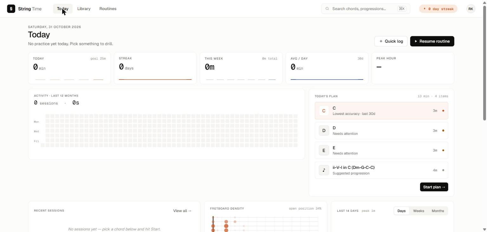

# String Time 🎸

A guitar practice tracker that runs entirely in your browser. No account, no
backend, no tracking. Your practice data lives in your own device.

Live: **https://stringtime.app**



## What it does

- **Practice** — pick a chord or progression, set BPM (40–240) and time
  signature (4/4, 3/4, 6/8). A 4-bar horizontal playhead stays locked to
  the audio clock so audio and visuals never drift.
- **Chord audio** — a plucked-string synth with per-string decay, brightness
  and pick-attack. Each strum is staggered across six strings with a bit of
  jitter so it feels hand-played.
- **Progressions** — build custom chord sequences, choose bars-per-chord
  (1, 2 or 4), drag to reorder.
- **Custom chords** — click fretboard positions or type `x 3 2 0 1 0` style
  notation.
- **Routines** — ordered practice items with their own BPM, time signature,
  duration and optional per-item tempo-ramp percent. Start one item or run
  the whole routine back-to-back.
- **Categories** — group chords or progressions into tags.
- **Today's plan** — picks three chords and a progression to drill based on
  recent accuracy, days since last practice, and BPM plateau detection.
- **History & stats** — GitHub-style 365-day heatmap, days/weeks/months
  chart, current and longest streak, average minutes/day, most active hour,
  per-chord totals, and a fretboard-density map.
- **Profile** — set your name, see what's stored, reset stats or wipe
  everything. Export / Import JSON backups you can carry between browsers.
- **Private by default** — everything stays in your browser. Nothing is
  sent anywhere.

## Running it locally

Any static file server works. The simplest:

```bash
cd public && python -m http.server 8766
```

Then open <http://127.0.0.1:8766>. The app seeds itself on first load.

## License

String Time is © 2026 Rahul S Rajan, released under the
[Creative Commons Attribution-NonCommercial 4.0 International](https://creativecommons.org/licenses/by-nc/4.0/)
license (CC BY-NC 4.0). You may use, share and adapt the project for
non-commercial purposes with attribution. Commercial use requires a
separate agreement.

See [`LICENSE`](LICENSE) for the full notice.
